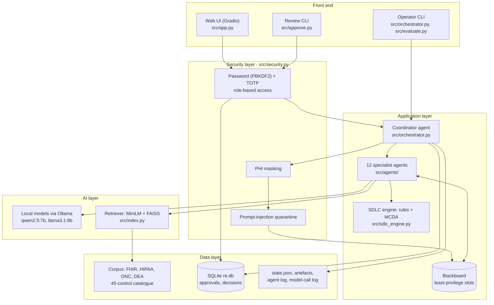
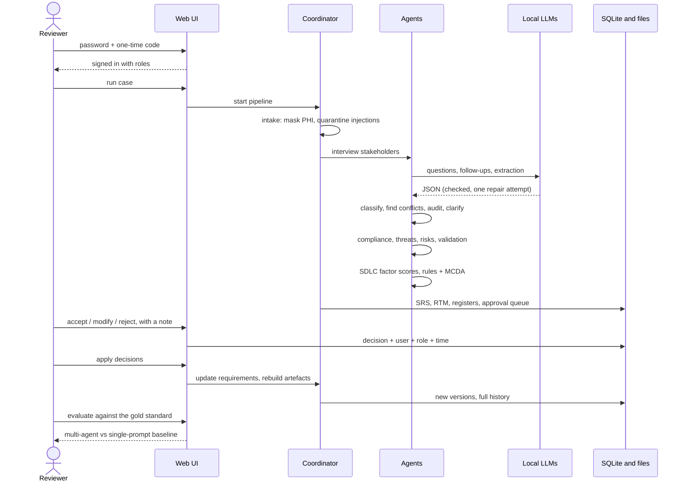
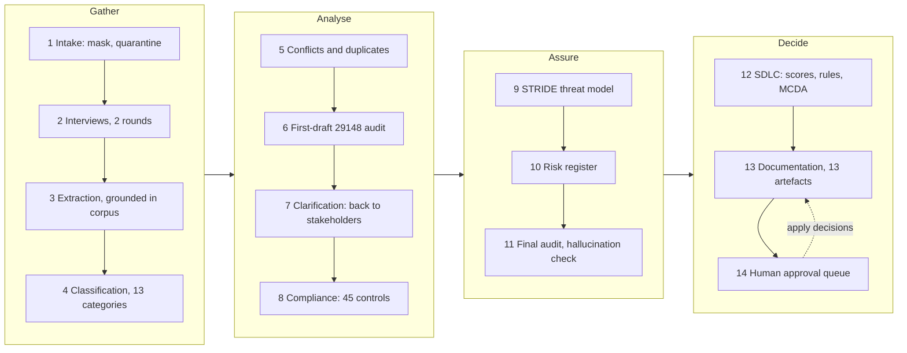

# Architecture

## 1. System layers: front end to back end

## 2. One case, end to end

## 3. The 14 pipeline steps

The model perceives, the engine decides: both models only score 13 project factors; a
transparent rules and weighted-scoring engine ranks the SDLC models, and people sign it off.
