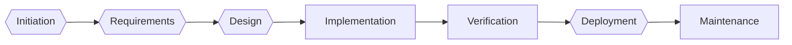

# SDLC recommendation

**Recommended:** Waterfall (79.2%) — runner-up V-Model. Status: pending approval by project manager, architect, security officer, compliance officer.

| Rank | Model | Suitability | Supporting rules |
|---|---|---|---|
| 1 | Waterfall | 79.2% | R-WF |
| 2 | V-Model | 75.0% | R-V |
| 3 | Hybrid | 65.6% | — |
| 4 | Spiral | 57.5% | — |
| 5 | DevSecOps | 54.2% | — |
| 6 | Agile | 35.4% | — |

## Decision factors (median of both models)

| Factor | Score |
|---|---|
| requirement_instability | 1 |
| regulatory_criticality | 5 |
| security_risk | 4.5 |
| project_complexity | 3.5 |
| system_size | 4 |
| legacy_dependence | 3 |
| change_frequency | 2 |
| continuous_delivery_need | 3 |
| stakeholder_availability | 4 |
| documentation_rigour | 4 |
| schedule_budget_rigidity | 5 |
| formal_verification_need | 3.5 |
| failure_consequence | 4.5 |

Contested (models differ by 2+ points): system_size, legacy_dependence, change_frequency, continuous_delivery_need, stakeholder_availability

**Escalated:** near tie: Waterfall 79.2% vs V-Model 75.0%; the two models disagree by 2+ points on: system_size, legacy_dependence, change_frequency, continuous_delivery_need, stakeholder_availability

## Justification

Waterfall ranks first for this project due to its stable requirements and extensive approvals, which align with the stringent regulatory environment and well-defined functional and non-functional requirements. The V-Model is the runner-up because it emphasizes strict verification and validation, crucial for handling sensitive patient data and ensuring compliance with HIPAA regulations. These factors are critical given the high security risk and regulatory criticality.

Strongest argument against: While Waterfall ensures stable requirements and extensive approvals, it may struggle with change control and flexibility, which could be a challenge given the fixed go-live date and the need for quarterly releases after go-live.

## Project workflow — Waterfall

| # | Phase | Activities | Roles | Deliverables | Security | Compliance checkpoints | Exit criterion | Approval gate |
|---|---|---|---|---|---|---|---|---|
| 1 | Initiation | Define scope and objectives; Select SDLC and plan | project_manager, product_owner | Project charter; SDLC decision record |  |  | Charter and SDLC decision approved | project_manager, architect, security_officer, compliance_officer (RTM checked) |
| 2 | Requirements | Elicit and analyse requirements; Baseline the SRS; Clinical hazard identification | business_analyst, product_owner, compliance_officer | SRS baseline; Traceability matrix |  | HIPAA risk analysis completed and approved (45 CFR 164.308(a)(1)(ii)(A)) | SRS baselined | product_owner, compliance_officer (RTM checked) |
| 3 | Design | Architecture and detailed design | architect | Design specification | Threat modelling (STRIDE) of the functionality; Security requirements review |  | Design approved | architect, security_officer (RTM checked) |
| 4 | Implementation | Build to the design; Unit test | developer | Code; Unit test results | Static application security testing on every build; Dependency and secret scanning |  | Code complete |  |
| 5 | Verification | Integration and system test against the SRS | tester | Test report | Dynamic application security testing; Penetration test before release |  | All requirements verified |  |
| 6 | Deployment | Release and hand-over; Clinical safety case approved | operations, project_manager | Release notes | Security sign-off | ONC certification testing passed for the applicable 45 CFR 170.315 criteria; Third-party EPCS audit or certification passed before use (21 CFR 1311.300) | Accepted into service | project_manager, clinical_safety_officer, security_officer, compliance_officer (RTM checked) |
| 7 | Maintenance | Corrective maintenance; Change control | operations | Change log | Security monitoring and incident response; Vulnerability patching to an agreed timescale | Security documentation retained for 6 years (45 CFR 164.316(b)(2)(i)); Daily audit-trail analysis with incident reporting within one business day (21 CFR 1311.150); Re-audit when signing functionality changes or every two years (21 CFR 1311.300) | Retirement |  |

## Project-specific activities

- **Initiation:** Identify key stakeholders and their roles in the e-Rx system
- **Initiation:** Conduct a risk assessment for the e-Rx system, focusing on patient safety and data security
- **Requirements:** Develop a detailed use case for the e-Rx system, including interaction and allergy checking scenarios
- **Requirements:** Conduct a clinical trial with prescribers to validate the real-time interaction and allergy alerts
- **Design:** Create a prototype of the user interface for real-time interaction and allergy alerts
- **Design:** Develop a security architecture that supports NFR-ERX-013 and NFR-ERX-014
- **Implementation:** Implement the real-time interaction and allergy checking functionality
- **Implementation:** Perform unit testing on the interaction and allergy alerting system
- **Verification:** Integrate the real-time interaction and allergy checking with the EHR system
- **Verification:** Conduct integration testing to ensure the system meets FR-ERX-002 and FR-ERX-003
- **Deployment:** Deploy the system to a small pilot group of prescribers for a limited time
- **Deployment:** Gather feedback from the pilot group on the real-time interaction and allergy alerts
- **Maintenance:** Monitor the system for any issues related to real-time interaction and allergy checking
- **Maintenance:** Update the audit logs and security documentation as required by NFR-ERX-011
